# AGENT FLUX V2 — SYSTEM ARCHITECTURE & DIAGRAMS
**Complete Architectural Specification, Component Interactions & Mermaid Models**  
*Document Ref: AFV2-AUDIT-ARCH-2026-10-28*  
*Repository: [https://github.com/Dhivithkumar/AgentFlux](https://github.com/Dhivithkumar/AgentFlux)*  

---

## CHAPTER Overview

This document presents 12 architectural and procedural Mermaid diagrams documenting the Agent Flux V2 platform. Each diagram directly reflects the inspected codebase, distinguishing verified synchronous HTTP/RPC calls from asynchronous BullMQ queue jobs and background poller routines.

---

## 1. High-Level System Architecture

### Architectural Description
The architecture separates client presentation (React 18 SPA), gateway routing and middleware (Express, JWT verification, tenant isolation), core business services (intake, knowledge, workflow, quotation, order, finance, vendor verification), asynchronous queues (BullMQ, Redis, event dispatchers), and persisted databases (PostgreSQL with pgvector, Prisma ORM, encrypted credential vault, and Google Workspace cloud services).

### Mermaid Diagram
```mermaid
graph TB
    subgraph Client Layer
        Web["React 18 Single Page App<br/>(Vite, Tailwind, React Flow)<br/>:3000"]
        ExtClient["External Customer Email / Webhook"]
    end

    subgraph API Gateway & Security Layer
        ExpressApp["Express API Server (:3001)<br/>(apps/api/src/index.ts)"]
        AuthMid["authenticate<br/>(JWT Token Extraction)"]
        TenantMid["requireBusinessMembership<br/>(Prisma Membership Check)"]
        AESVault["AES-256-GCM Vault<br/>(services/encryption.ts)"]
    end

    subgraph Autonomous Intake & Grounding
        Poller["EmailPoller / OperationalPoller<br/>(services/queue/emailPoller.ts)"]
        Orchestrator["ConversationOrchestrator<br/>(services/intake/ConversationOrchestrator.ts)"]
        QueryNorm["QueryUnderstandingService<br/>(Intent & Entity Normalizer)"]
        HybridRAG["HybridRetrievalEngine<br/>(Exact + Customization + Vector)"]
        GroundedResp["GroundedResponseService<br/>(Zero-Hallucination Enforcer)"]
        FinEngine["DeterministicFinancialEngine<br/>(Pricing, GST, Payment Terms)"]
    end

    subgraph Workflow & Background Processing
        WFEngine["WorkflowEngine<br/>(services/workflow/engine.ts)"]
        ActionReg["ActionRegistry & ActionExecutor<br/>(services/workflow/actionRegistry.ts)"]
        CondEngine["ConditionEngine<br/>(services/workflow/conditionEngine.ts)"]
        RedisServer["Redis Queue Broker (:6379)<br/>(services/queue/connection.ts)"]
        BullQueues["BullMQ Queues<br/>(workflow, knowledge, vendor, analytics)"]
        Workers["BullMQ Background Workers"]
    end

    subgraph Data & Persistence Layer
        PrismaORM["Prisma ORM Client 5.22.0<br/>(packages/database/index.ts)"]
        PostgresDB[("PostgreSQL 15+ & pgvector<br/>(Relational Tables + vector embeddings)")]
        LocalFS["Local File Storage<br/>(uploads/ / temp/)"]
    end

    subgraph External Provider Services
        GeminiAPI["Google Gemini 3.7 Flash<br/>(@google/generative-ai)"]
        GroqAPI["Groq Llama-3 Fallback<br/>(groq-sdk)"]
        GoogleDrive["Google Drive API<br/>(Authoritative Archiving)"]
        GoogleSheets["Google Sheets API<br/>(Operational Spreadsheet Sync)"]
        GoogleCal["Google Calendar API<br/>(Meeting Availability & Meet)"]
        GmailAPI["Gmail API<br/>(Inbound Read & Outbound Send)"]
    end

    Web -->|HTTP REST / JSON| ExpressApp
    ExtClient -->|Inbound Email| GmailAPI
    ExpressApp --> AuthMid --> TenantMid
    TenantMid --> Orchestrator
    TenantMid --> WFEngine
    Poller -->|Poll Unread (10s)| GmailAPI
    Poller --> Orchestrator
    Orchestrator --> QueryNorm --> HybridRAG
    HybridRAG --> FinEngine
    HybridRAG --> GroundedResp
    HybridRAG --> GeminiAPI
    HybridRAG --> PrismaORM
    GroundedResp --> GeminiAPI
    WFEngine --> ActionReg
    WFEngine --> CondEngine
    WFEngine --> BullQueues
    BullQueues --> RedisServer
    RedisServer --> Workers --> WFEngine
    ActionReg --> GmailAPI
    ActionReg --> GoogleSheets
    ActionReg --> GoogleDrive
    ActionReg --> GoogleCal
    PrismaORM --> PostgresDB
    AESVault -.->|Decrypt Tokens| ActionReg
    AESVault -.->|Decrypt Tokens| Poller
```

---

## 2. Frontend-to-Backend Architecture

### Architectural Description
The frontend is structured as a modular React 18 single-page application built with Vite. It features a persistent dashboard layout (`DashboardLayout.tsx`) managing business switching via localStorage and global state, wrapping specialized business centres (Dashboard Overview, Enquiry Inbox, Orders, Finance Centre, Vendor Centre, Workflow Centre, Knowledge Base, and Settings). All API requests route through `lib/api.ts`, which injects the `Bearer` token and `x-business-id` header.

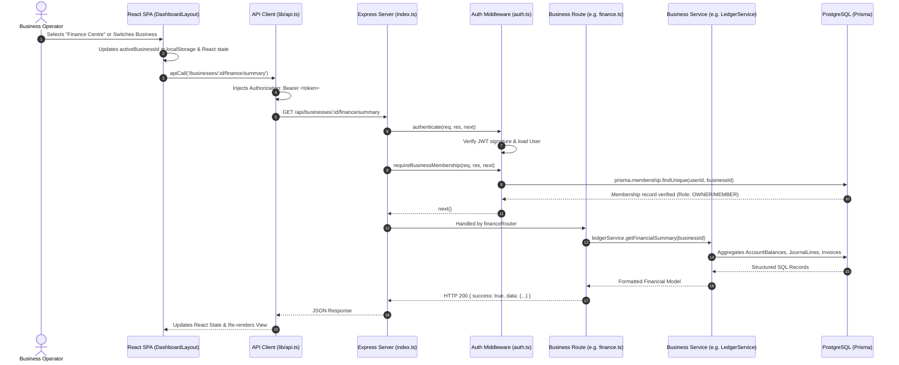

---

## 3. Database Entity-Relationship Architecture (Prisma Schema)

### Architectural Description
The data layer utilizes PostgreSQL with the `pgvector` extension. Multi-tenancy is enforced via a top-level `Business` model referencing `User` via `Membership`. The schema is partitioned into:
1. Multi-tenant Identity & OAuth Credentials (`User`, `Business`, `Membership`, `Integration`, `IntegrationCredential`, `OAuthState`, `AuditLog`)
2. Workflow Execution DAG (`Workflow`, `WorkflowVersion`, `WorkflowStep`, `WorkflowExecution`, `WorkflowStepExecution`, `WorkflowApproval`, `WorkflowConnectorBinding`)
3. Knowledge & RAG (`KnowledgeBase`, `KnowledgeSource`, `KnowledgeDocument`, `KnowledgeChunk` with vector embeddings)
4. Commercial Intake & Order Lifecycle (`Customer`, `Enquiry`, `Order`, `OrderStatusHistory`, `Quotation`, `Invoice`, `DocumentTemplate`, `Payment`)
5. Operational Sync (`OperationalSheetConfig`, `OperationalSyncJob`)
6. Double-Entry General Ledger (`Account`, `JournalEntry`, `JournalLine`, `AccountingPeriod`, `AccountBalance`, `BankFeedAccount`, `BankTransaction`, `BankTransactionMatch`, `FinanceAuditLog`)
7. Vendor Verification (`Vendor`, `VendorVerificationLog`)

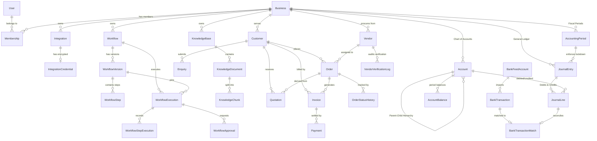

---

## 4. RAG Document Ingestion Pipeline

### Architectural Description
Document ingestion (`apps/api/src/services/knowledge.ts`) processes PDF, plain text, CSV, and DOCX files.
1. The file is uploaded and marked `UPLOADED`.
2. Text extraction utilizes `pdf-parse` for PDFs, `mammoth` for DOCX, or buffer decoding for CSV/text (`status: EXTRACTING`).
3. Document-Aware Chunking splits text along section, paragraph, and table row boundaries (`status: CHUNKING`).
4. `GeminiEmbeddingProvider` invokes Google Gemini `gemini-embedding-001` or `text-embedding-004` to generate vectors (`status: EMBEDDING`).
5. Vectors are inserted into PostgreSQL `KnowledgeChunk` using raw SQL with the `::vector` type cast.
6. The document is updated to `INDEXED` with `processedAt` timestamp.

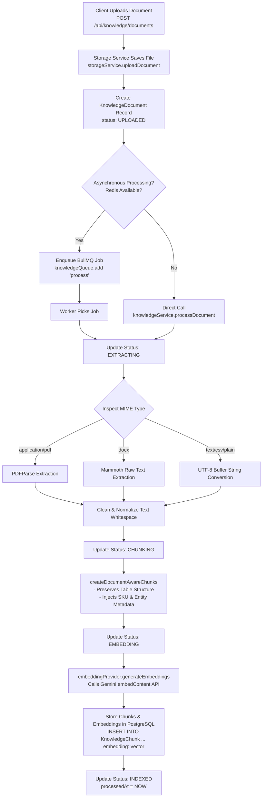

---

## 5. RAG Retrieval & Grounding Pipeline

### Architectural Description
Retrieval (`HybridRetrievalEngine.ts` and `GroundedResponseService.ts`) runs a 5-tier multi-strategy pipeline:
1. **Query Normalization:** `QueryUnderstandingService` parses product names, SKUs, customizations, discounts, or credit requests.
2. **Tenant Scoping:** Confirms query belongs strictly to the authenticated tenant.
3. **Structured Entity Matching:** Matches against authoritative catalog definitions with 1.0 confidence score.
4. **Deterministic Calculation:** Calculates pricing, 18% GST, 50% advance, and balance due.
5. **Governance Evaluation:** Evaluates discount policies (0-5% Sales, 5-10% Manager, >10% Owner).
6. **Vector Search:** Queries pgvector using `1 - (c."embedding" <=> $1::vector)` as fallback or supplementary evidence.
7. **Grounding Validation:** Enforces zero-hallucination assertions before returning response.

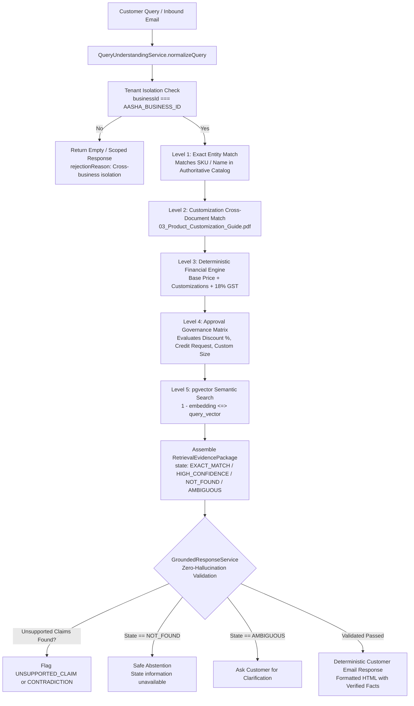

---

## 6. Workflow DAG Execution Architecture

### Architectural Description
The workflow execution engine (`apps/api/src/services/workflow/engine.ts`) executes Directed Acyclic Graphs (DAGs) pinned immutably to a `WorkflowVersion`. 
- **Graph Traversal:** Calculates incoming edge counts (`incomingEdges`). Nodes with 0 incoming dependencies execute as root nodes.
- **Node Execution:** Dispatches based on step type (`TRIGGER`, `ACTION`, `TOOL_ACTION`, `CONDITION`, `APPROVAL`, `DELAY`, `WAIT_FOR_EVENT`, `AI_AGENT`, `RAG_SEARCH`).
- **Parallel Branching:** Concurrent branches execute via `Promise.all()`.
- **Suspension:** Waiting steps (`APPROVAL`, `DELAY`, `WAIT_FOR_EVENT`) set `_suspend: true` and persist context.

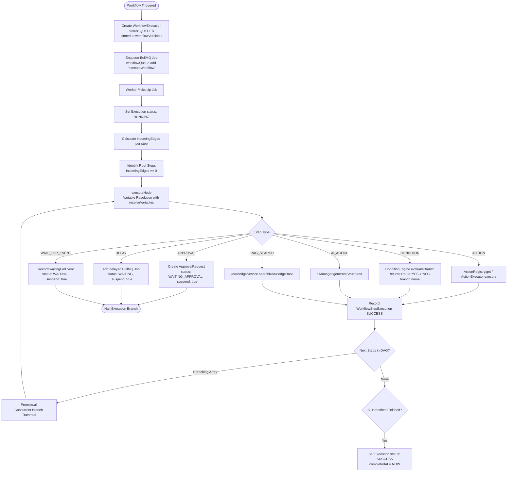

---

## 7. Event-to-Worker Asynchronous Processing Sequence

### Architectural Description
Demonstrates how an asynchronous operational event (e.g., `ORDER_CONFIRMED`) propagates across the event dispatcher, dynamic tenant workflows, BullMQ queues, background workers, and downstream system hooks.

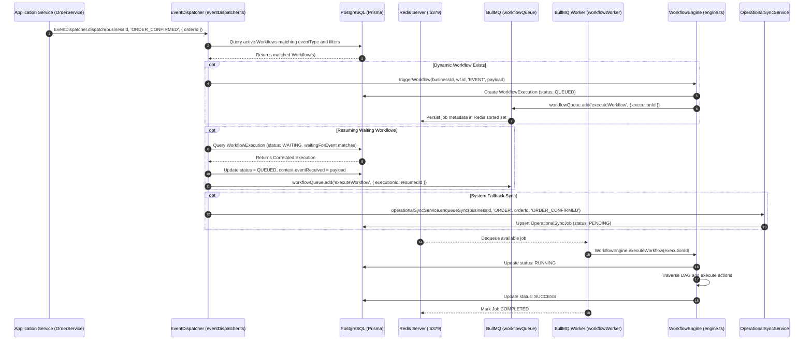

---

## 8. Human-in-the-Loop Approval & Resumption Architecture

### Architectural Description
When a workflow step requires human approval (e.g., a 12% discount or credit request), the step execution halts, saves execution state, and creates an `ApprovalRequest` record. The business owner reviews the approval in the UI (`/dashboard/workflows/approvals`). Upon decision, the approval service resumes the execution via BullMQ.

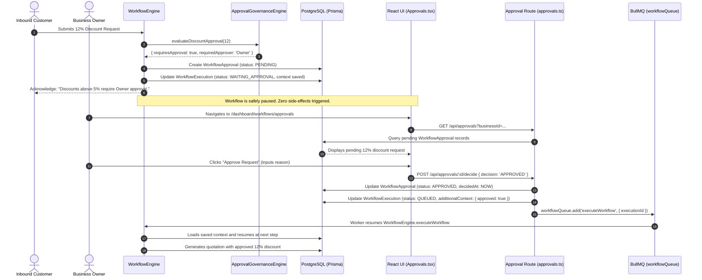

---

## 9. Order-to-Invoice Lifecycle & Financial Invariant Flow

### Architectural Description
This sequence traces the transition from customer quotation acceptance to order confirmation, customer billing address intake, PDF invoice rendering, Google Drive archiving, email dispatch, and General Ledger posting.

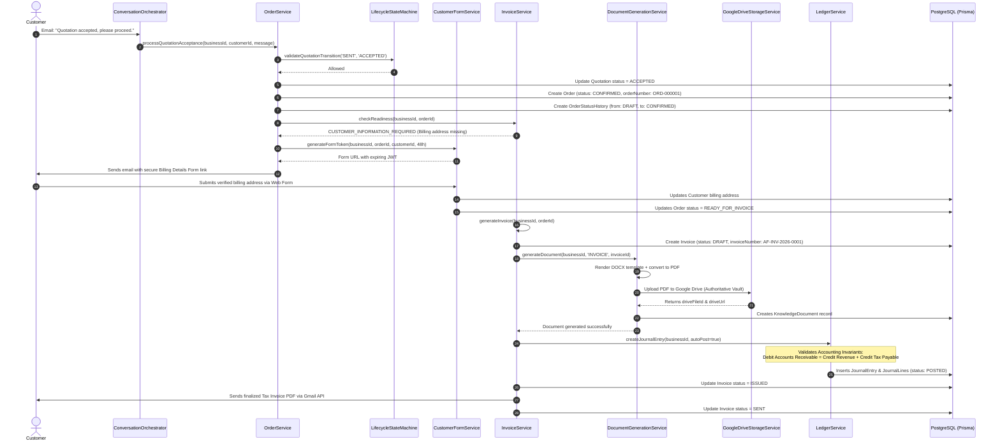

---

## 10. Error Handling, Retries & Worker Recovery Architecture

### Architectural Description
The error-handling architecture prevents duplicate side-effects while guaranteeing recovery from transient failures.
1. **Step-Level Retries:** Evaluates `retryPolicy` on individual steps (up to `maxAttempts` with configurable `delayMs`).
2. **Failure Policies:** Evaluates `failurePolicy` (`FAIL_FAST` stops execution; `CONTINUE_ON_FAILURE` logs error and advances via `ON_FAILURE` branch).
3. **Queue-Level Retries:** BullMQ enforces exponential backoff (e.g. 5000ms delay, 3 attempts).
4. **Permanent Failure Handling:** Marks `WorkflowExecution` as `FAILED` and records exact error message.

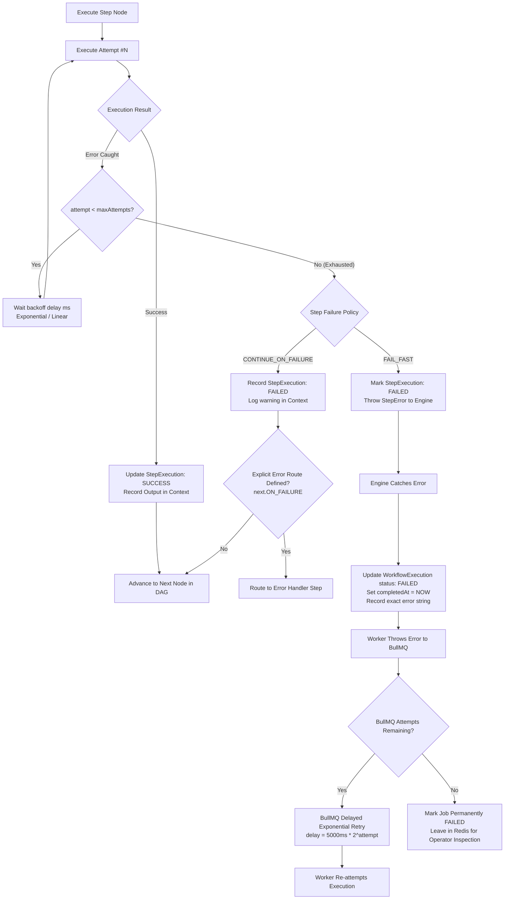

---

## 11. AI Provider Request & Response Sequence

### Architectural Description
`AIProviderManager` coordinates primary generation via Gemini 3.7 Flash and fallback generation via Groq. It classifies errors as retryable (429 rate limit, 500, 502, 503, 504, timeout, network failure) versus non-retryable (400 bad request, 401 unauthorized, invalid API key, obsolete model). Retryable errors trigger exponential backoff with jitter; unrecoverable primary failures switch to the fallback provider.

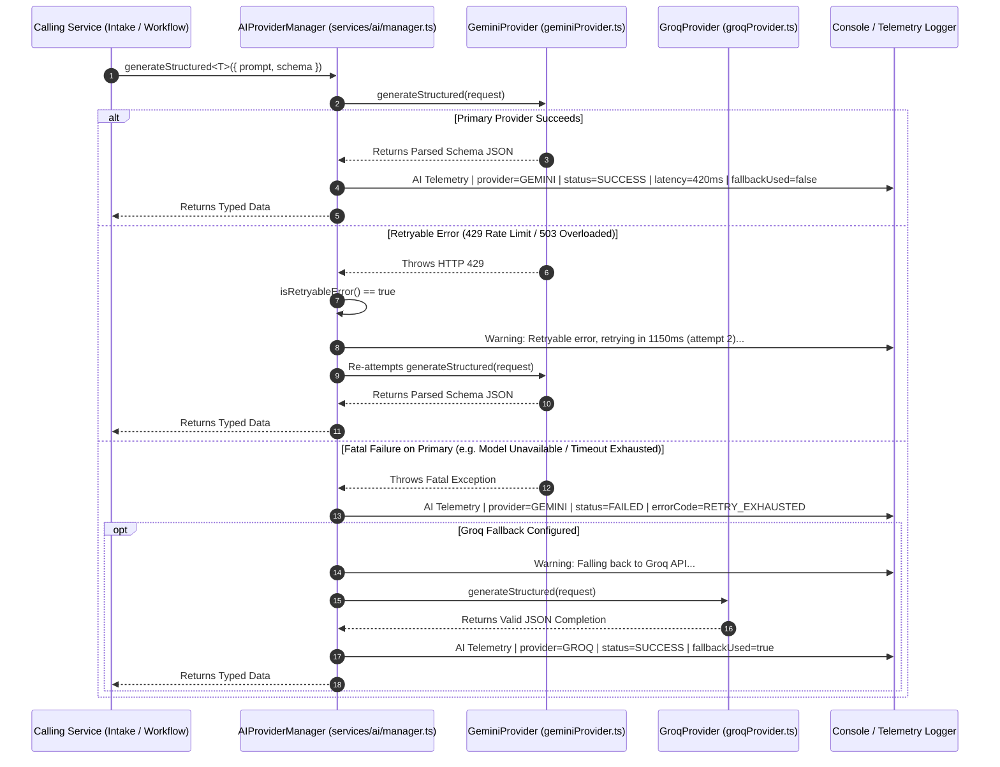

---

## 12. Authentication & Tenant-Isolation Architecture

### Architectural Description
Multi-tenant security requires that every request identifies the authenticated user and asserts business tenancy. The middleware extracts the JWT from headers, verifies the signature, and matches the requested `businessId` against the user's `Membership` records in the database. Cross-tenant data access is rejected with HTTP 403 Forbidden.

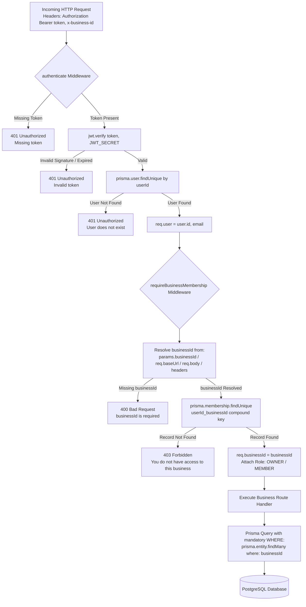
