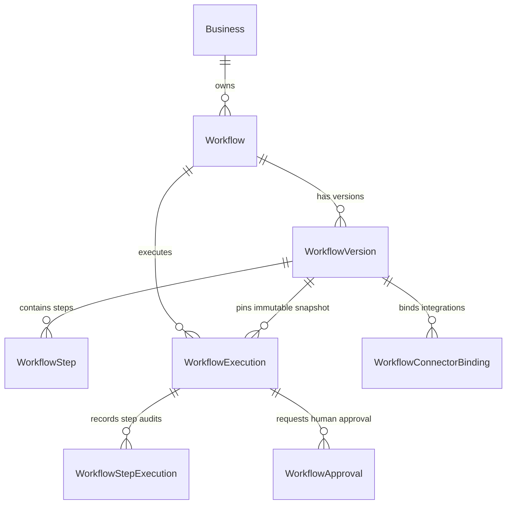
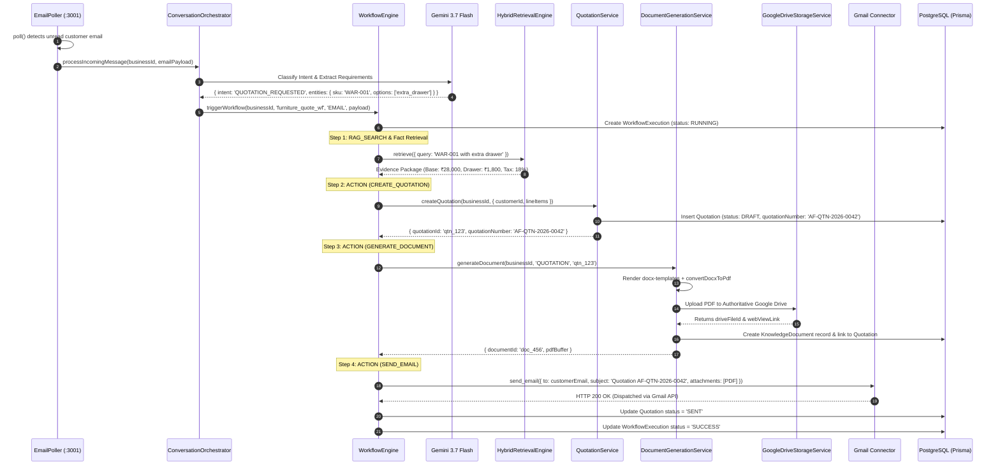

# AGENT FLUX V2 — WORKFLOW ENGINE & AUTOMATION DEEP DIVE
**DAG Execution, Variable Resolution, Human Approval Suspension & Asynchronous Processing**  
*Document Ref: AFV2-AUDIT-WF-2026-10-28*  
*Repository: [https://github.com/Dhivithkumar/AgentFlux](https://github.com/Dhivithkumar/AgentFlux)*  

---

## 1. Executive Technical Summary

The Agent Flux V2 Workflow Engine (`apps/api/src/services/workflow`) is an enterprise-grade DAG (Directed Acyclic Graph) automation orchestrator. It executes multi-step business procedures spanning customer communication, AI generation, conditional decision branching, human-in-the-loop approvals, and external software integrations.

### Key Architectural Characteristics
1. **Immutable Snapshot Versioning:** Workflows are edited as drafts. When activated, an immutable `WorkflowVersion` snapshot is pinned. In-flight executions reference this immutable version ID, ensuring schema updates never corrupt active executions.
2. **Topological Graph Traversal with Parallel Branching:** The engine dynamically parses step connections (`next`), calculates incoming dependency edges, detects root entry nodes, and traverses concurrent execution branches using asynchronous `Promise.all()` concurrency.
3. **Stateful Long-Running Suspension:** Steps requiring human approval (`APPROVAL`), delayed execution (`DELAY`), or external webhooks (`WAIT_FOR_EVENT`) cleanly suspend execution state to PostgreSQL and yield worker threads. Workflows are later resumed via BullMQ queue events without losing execution context.
4. **Idempotency & Concurrency Guards:** Workflows enforce unique compound keys (`businessId_workflowId_idempotencyKey`). Concurrent cancellation checks are evaluated before each step execution.
5. **Universal Variable Resolution:** The variable engine (`variableParser.ts`) resolves dot-path notation (`{{steps.step1.output.id}}`) and array indexes (`{{trigger.items[0].sku}}`), preserving raw data types for complex payloads.

---

## 2. Workflow Model & Schema Representation

The workflow data architecture is defined in `prisma/schema.prisma` across seven interconnected entities:



### 2.1 Entity Responsibilities
- `Workflow`: Top-level workflow entity storing name, category, status (`DRAFT`, `READY`, `ACTIVE`, `PAUSED`, `ARCHIVED`), and `activeVersionId`.
- `WorkflowVersion`: An immutable version snapshot (`versionNumber`, `definition` JSON, `trigger` JSON, `requiredCapabilities`).
- `WorkflowStep`: Represents individual nodes in the DAG (`stepId`, `stepOrder`, `type`, `config`, `inputSchema`, `outputSchema`, `next`, `retryPolicy`, `errorHandler`).
- `WorkflowExecution`: A runtime execution record (`status`: `QUEUED`, `RUNNING`, `WAITING_APPROVAL`, `WAITING`, `SUCCESS`, `FAILED`, `CANCELLED`; `context` JSON).
- `WorkflowStepExecution`: Audit log of each step execution with exact `inputData`, `outputData`, `status`, and `error`.
- `WorkflowApproval`: Human-in-the-loop approval requests created when a workflow enters `WAITING_APPROVAL`.
- `WorkflowConnectorBinding`: Binds required capabilities (e.g., `"EMAIL.SEND"`) to specific tenant integrations (e.g., Gmail account).

---

## 3. Workflow Triggering Mechanisms

Workflows can be initiated through three distinct pathways:

### 3.1 Event-Based Triggers (`EventDispatcher.ts`)
The application-wide event bus (`EventDispatcher.dispatch`) checks active workflows for the tenant:
```typescript
// apps/api/src/services/workflow/eventDispatcher.ts (Lines 29-42)
const triggerConfig = activeVersion.trigger as any;
const matchesEvent = triggerConfig?.type === 'EVENT' && 
  (triggerConfig?.eventType === eventType || triggerConfig?.event === eventType);

if (matchesEvent) {
  if (triggerConfig.filters) {
    const isMatch = ConditionEngine.evaluate(triggerConfig.filters, {
      event: payload, trigger: payload, ...payload
    });
    if (!isMatch) continue;
  }
  await WorkflowEngine.triggerWorkflow(businessId, wf.id, 'EVENT', payload);
}
```

### 3.2 Scheduled Triggers (Cron / BullMQ Schedulers)
Scheduled workflows are registered in BullMQ using `workflowQueue.upsertJobScheduler`:
```typescript
// apps/api/src/services/queue/workflowQueue.ts (Lines 48-55)
await workflowQueue.upsertJobScheduler(
  `cron-${workflowId}`,
  { pattern: cron },
  {
    name: 'executeWorkflow',
    data: { workflowId, businessId, isScheduled: true }
  }
);
```

### 3.3 Manual / Direct API Triggers
External applications trigger workflows directly via `POST /api/workflows/:id/trigger`:
```typescript
await WorkflowEngine.triggerWorkflow(
  businessId, workflowId, triggerType, triggerPayload, idempotencyKey
);
```

---

## 4. Graph Traversal & DAG Algorithm

**File:** `apps/api/src/services/workflow/engine.ts` (Method: `executeWorkflow`)

### 4.1 Dependency Edge Calculation
The engine avoids assuming linear step ordering by dynamically calculating incoming dependency edges across all steps:
```typescript
// apps/api/src/services/workflow/engine.ts (Lines 273-288)
const incomingEdges: Record<string, number> = {};
steps.forEach(s => incomingEdges[s.stepId] = 0);
steps.forEach(s => {
  const nextConf = s.next as any;
  if (Array.isArray(nextConf)) {
    nextConf.forEach(n => { if (incomingEdges[n] !== undefined) incomingEdges[n]++; });
  } else if (typeof nextConf === 'object' && nextConf !== null) {
    Object.values(nextConf).forEach((target: any) => {
      if (Array.isArray(target)) {
        target.forEach(n => { if (incomingEdges[n] !== undefined) incomingEdges[n]++; });
      } else if (typeof target === 'string' && incomingEdges[target] !== undefined) {
        incomingEdges[target]++;
      }
    });
  }
});
```

### 4.2 Root Entry Point Identification
Nodes with zero incoming edges (`incomingEdges[s.stepId] === 0`) are identified as roots and scheduled concurrently:
```typescript
let initialNodes = steps.filter(s => incomingEdges[s.stepId] === 0).map(s => s.stepId);
if (initialNodes.length === 0) {
  const firstStep = steps.find(s => s.stepOrder === 1) || steps[0];
  if (firstStep) initialNodes = [firstStep.stepId];
}
await Promise.all(initialNodes.map(id => runNode(id)));
```

### 4.3 Concurrent Branch Execution
When a step finishes, its `next` targets are launched in parallel using `Promise.all`:
```typescript
// apps/api/src/services/workflow/engine.ts (Lines 470-471)
const promises = nextNodes.map(id => runNode(id));
await Promise.all(promises);
```

### 4.4 Concurrency & Cancellation Check
To guarantee that user-cancelled executions do not execute orphaned downstream steps, every node verifies database execution status before firing:
```typescript
// apps/api/src/services/workflow/engine.ts (Lines 296-303)
const currentExec = await prisma.workflowExecution.findUnique({
  where: { id: executionId },
  select: { status: true }
});
if (currentExec?.status === ExecutionStatus.CANCELLED) {
  console.log(`Execution ${executionId} cancelled. Halting step ${stepId}`);
  return;
}
```

---

## 5. Comprehensive Step Types & Execution Logic

**File:** `apps/api/src/services/workflow/engine.ts` (Method: `executeNode`)

The engine natively implements 9 discrete step types:

| Step Type | Configuration Keys | Execution Logic | Failure & Continuation Behavior |
| :--- | :--- | :--- | :--- |
| `TRIGGER` | None | Returns `context.trigger` payload. | Always succeeds; initiates DAG data flow. |
| `ACTION` | `actionId`, `connector`, `action`, `to`, `subject`, `body` | Checks `ActionRegistry.get(actionId)` or executes direct connector action (e.g. Gmail send). | Retried per `retryPolicy`. If failure policy is `FAIL_FAST`, halts execution. |
| `TOOL_ACTION` / `CONNECTOR_ACTION` | `capability`, `connectorId`, `actionId` | Resolves capability binding via `WorkflowConnectorBinding`, decrypts token, and invokes connector provider. | Retried per policy. Sensitive credentials scrubbed from persisted logs. |
| `CONDITION` | `branches: [{ route, condition }]` or `condition` | Invokes `ConditionEngine.evaluateBranch`. Returns `{ route, evaluated: true }`. | Pure evaluation. Route drives next branch selection (`YES`, `NO`, or named route). |
| `APPROVAL` | None (reads context) | Invokes `ApprovalService.createApprovalRequest`. Sets `_suspend: true`, returns status `WAITING_APPROVAL`. | Halts branch cleanly. Execution awaits human intervention via UI. |
| `DELAY` | `delayMs` | Enqueues delayed BullMQ job with `delay: delayMs`. Sets `_suspend: true`, returns `WAITING_DELAY`. | Yields worker thread; automatically re-enqueued when timer expires. |
| `WAIT_FOR_EVENT`| `eventType`, `correlation` | Checks `context.metadata.eventReceived`. If missing, sets `_suspend: true`, returns `WAIT_FOR_EVENT`. | Halts branch. Resumed when `EventDispatcher` receives matching correlated event. |
| `AI_AGENT` / `AI_TASK` | `task`, `outputSchema` | Invokes `aiManager.generateStructured` using Gemini with structured output validation. | Retried per `AIConfiguration.gemini.maxRetries`. Falls back to Groq if configured. |
| `RAG_SEARCH` | `query`, `limit` | Resolves variables in query, invokes `knowledgeService.searchKnowledgeBase`. | Returns `SUCCESS_WITH_RESULTS` or `SUCCESS_NO_RESULTS`. If retrieval fails, marked `retryable: true`. |

---

## 6. Variable Resolution Engine

**File:** `apps/api/src/services/workflow/variableParser.ts`

### 6.1 Syntax & Dot-Notation Pathing
Variables use the standard Handlebars-style syntax: `{{path.to.variable}}`. The parser traverses nested context layers:
- `trigger`: Initial event/trigger payload.
- `config`: Workflow-level configurations.
- `steps`: Step outputs indexed by step ID (`steps.extract_enquiry.output.sku`).
- `variables`: Workflow mutable variables.
- `metadata`: System execution metadata.

### 6.2 Raw Type Preservation vs String Interpolation
A critical technical feature of `variableParser.ts` is type preservation:
```typescript
// apps/api/src/services/workflow/variableParser.ts (Lines 34-43)
// If the entire string is just one variable, return its raw resolved type (preserving arrays/objects)
const exactMatch = str.match(/^\{\{([^}]+)\}\}$/);
if (exactMatch) {
  const path = exactMatch[1].trim();
  const value = getNestedValue(context, path);
  return value === undefined ? null : value;
}

// Otherwise do string replacement
return str.replace(variableRegex, (match, path) => {
  const value = getNestedValue(context, path.trim());
  if (value === undefined) return '';
  if (typeof value === 'object') return JSON.stringify(value);
  return String(value);
});
```
This enables passing complex JSON objects (e.g. `{{steps.quote.output.lineItems}}`) directly into downstream action inputs without string corruption.

---

## 7. Action Registry & Connector Registry

**Files:** `apps/api/src/services/workflow/actionRegistry.ts` and `apps/api/src/connectors/registry.ts`

### 7.1 Internal Registered Actions
`ActionRegistry` provides centralized registration for core domain operations:
1. `CREATE_CUSTOMER`: Creates new customer record with source tracking.
2. `CREATE_ENQUIRY`: Creates enquiry record with structured metadata.
3. `CREATE_ORDER`: Calculates sequential order number (`ORD-XXXXXX`) and persists draft order.
4. `CREATE_QUOTATION`: Calls `QuotationService.createQuotation` with line items.
5. `SEND_QUOTATION`: Transitions quotation to `SENT` and logs requester audit.
6. `GENERATE_DOCUMENT`: Triggers DOCX template rendering and PDF generation.
7. `PROCESS_INBOUND_EMAIL`: Core email routing engine. Classifies email into `QUOTATION_ACCEPTANCE`, `QUOTATION_REQUEST`, or `GENERIC_ENQUIRY`.
8. `PROCESS_QUOTATION_ACCEPTANCE`: Triggers order creation, Google Sheets sync, and invoice generation.

### 7.2 External Connector Actions
External connectors are registered in `apps/api/src/connectors`:
- **Gmail Actions:** `send_email`, `read_thread`, `create_draft`.
- **Google Calendar Actions:** `list_events`, `check_availability`, `find_alternatives`, `create_event`.
- **Google Sheets Actions:** `read_sheet`, `append_row`, `update_row`, `batch_update`.
- **Google Drive Actions:** `upload_file`, `create_folder`, `get_file_metadata`.

---

## 8. Retries, Failure Policies & Sensitive Sanitization

### 8.1 Step-Level Retry Policy
Individual steps support declarative retry policies:
```json
{
  "retryPolicy": {
    "maxAttempts": 3,
    "delayMs": 1000,
    "backoff": "exponential"
  }
}
```
If an error occurs, the engine delays execution and retries up to `maxAttempts`.

### 8.2 Failure Policies
- `FAIL_FAST` (Default): Immediately aborts the workflow, sets status to `FAILED`, and records the exact error stack.
- `CONTINUE_ON_FAILURE`: Records the step as `FAILED`, but allows the DAG to continue. If `next.ON_FAILURE` is configured, routes execution to an error-handling branch.

### 8.3 Sensitive Data Scrubbing
Before persisting `inputData` or `outputData` to `WorkflowStepExecution`, `engine.ts` scrubs sensitive parameters:
```typescript
// apps/api/src/services/workflow/engine.ts (Lines 702-715)
private static sanitize(obj: any): any {
  if (!obj) return obj;
  const copy = JSON.parse(JSON.stringify(obj));
  const hideKeys = ['password', 'token', 'secret', 'authorization'];
  const scrub = (target: any) => {
    if (typeof target !== 'object' || target === null) return;
    for (const key in target) {
      if (hideKeys.some(hk => key.toLowerCase().includes(hk))) target[key] = '[REDACTED]';
      else if (typeof target[key] === 'object') scrub(target[key]);
    }
  };
  scrub(copy);
  return copy;
}
```

---

## 9. Full Workflow Sequence Trace: Inbound Quotation Request

The diagram below traces an authentic execution of the Aasha Furniture quotation generation workflow from inbound email to PDF quotation delivery:


